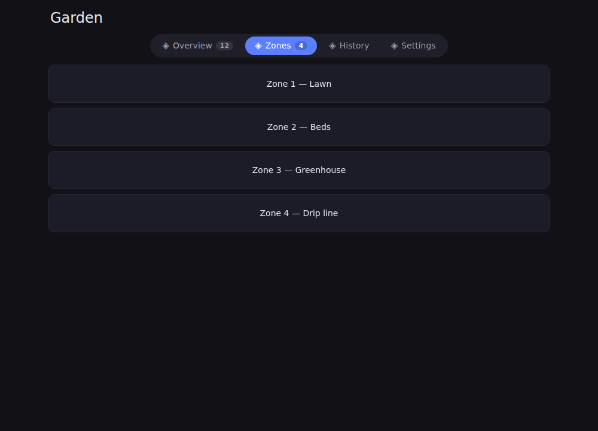

# Deck Card

[](https://github.com/hacs/integration)
[](https://github.com/RobinCK/lovelace-deck-card/releases)
[](LICENSE)

An adaptive **segmented container card** for Home Assistant dashboards.
Group any cards into segments ("pages of a deck") and flip through them:

- 🖥️ **Wide screens** — a segmented **pill bar** with icons, labels, badges and a smoothly sliding active indicator.
- 📱 **Narrow screens** — **swipe** between segments with rubber-band edges + **dot indicators**.

It is **one component with one breakpoint**, not two cards: the segment logic is shared, only the navigation layer adapts.

| Desktop (pills) | Mobile (swipe + dots) |
| --- | --- |
|  |  |

## Installation

### HACS (recommended)

1. HACS → menu (⋮) → **Custom repositories**
2. Add `https://github.com/RobinCK/lovelace-deck-card` with category **Dashboard**
3. Search for **Deck Card**, install, and reload your browser

### Manual

1. Download `deck-card.js` from the [latest release](https://github.com/RobinCK/lovelace-deck-card/releases)
2. Copy it to `config/www/deck-card.js`
3. Add the resource: **Settings → Dashboards → ⋮ → Resources**
   `/local/deck-card.js`, type **JavaScript module**

## Quick start

```yaml
type: custom:deck-card
segments:
  - name: Overview
    icon: mdi:view-dashboard
    cards:
      - type: weather-forecast
        entity: weather.home
  - name: Zones
    icon: mdi:sprinkler
    badge: 4
    cards:
      - type: entities
        entities:
          - switch.zone_1
          - switch.zone_2
  - name: History
    icon: mdi:chart-line
    cards:
      - type: history-graph
        entities:
          - sensor.soil_moisture
```

That's it — pills on desktop, swipe + dots on the phone, no extra configuration.

## Options

| Name | Type | Default | Description |
| --- | --- | --- | --- |
| `type` | string | **required** | `custom:deck-card` |
| `segments` | list | **required** | The segments of the deck (see below) |
| `title` | string | — | Optional header above the deck |
| `nav` | string | `auto` | Navigation style: `auto`, `pills`, `dots`, `hidden` |
| `breakpoint` | number | `640` | Viewport width (px) below which `auto` switches to dots + swipe |
| `default_segment` | number/string | `0` | Segment shown on load — 0-based index or segment `name` |
| `remember` | boolean | `false` | Reopen the last active segment on this device |
| `swipe` | boolean | `true` | Touch swiping between segments |
| `animation` | boolean | `true` | Slide/height/indicator animations |
| `min_card_width` | number/string | — | Lay cards out in responsive columns at least this wide (e.g. `340`). Omit for a single column |
| `key` | string | auto | Explicit storage key for `remember` (for identical decks on different views) |

### Segment options

| Name | Type | Default | Description |
| --- | --- | --- | --- |
| `name` | string | — | Pill label / accessible name |
| `icon` | string | — | Icon shown in the pill, e.g. `mdi:sprinkler` |
| `badge` | string/number | — | Small static counter/text in the pill |
| `cards` | list | `[]` | Any Lovelace cards |
| `min_card_width` | number/string | card-level value | Per-segment override of the responsive column width |

### Multi-column layout

By default a segment stacks its cards in one column. There are two ways to get columns:

#### 1. Native `grid_options` (recommended)

Give cards the same `grid_options.columns` you already use in sections dashboards — deck-card understands it natively (HA itself ignores `grid_options` inside container cards, so deck-card re-implements the sections sizing model):

- every **~350px** of deck width = one virtual dashboard column of **12 units**, so on a 4-column-wide desktop deck `columns: 12` = quarter, `24` = half, `full` = the whole row — exactly like your sections views;
- on narrow screens the unit count shrinks and spans clamp, so everything collapses to a single column automatically;
- cards without `grid_options` default to 12 units; `rows` is ignored (heights stay natural).

```yaml
type: custom:deck-card
segments:
  - name: Sensors
    icon: mdi:sprout
    cards:
      - type: tile
        entity: sensor.soil_1
        grid_options:
          columns: 12          # quarter of a wide deck, full width on a phone
      - type: custom:mini-graph-card
        entities: [sensor.soil_1]
        grid_options:
          columns: 24          # half
      - type: history-graph
        entities: [sensor.soil_1]
        grid_options:
          columns: full        # whole row
```

#### 2. `min_card_width` (auto-fill)

Alternatively set `min_card_width` (card-level or per segment) and the segment packs as many equal columns as fit, each at least that wide — handy when you don't want to size cards individually. In this mode `deck_span: full` (or `deck_span: N`) on a card takes the whole row / N columns; the hint is consumed by deck-card and never reaches the child card. `min_card_width` takes precedence over `grid_options` within a segment.

### Navigation modes

- **`auto`** *(default)* — pills on wide viewports, dots on narrow ones. One adaptive component, one breakpoint.
- **`pills`** — always show the pill bar (it scrolls horizontally when it overflows, keeping the active pill centered).
- **`dots`** — always show dots.
- **`hidden`** — no navigation at all: pure swipe (kiosk/minimal setups).

## UX details

- **Swipe** follows your finger 1:1, with rubber-band resistance at the first/last segment. Release past ~20% of the width — or flick — to advance; anything less snaps back.
- Swiping never triggers taps on the cards underneath, and gestures that start on sliders, maps or input fields are left alone.
- Vertical scrolling is never hijacked — only clearly horizontal gestures switch segments.
- The container **animates its height** to the active segment, so cards below the deck don't jump.
- **Keyboard**: focus the pill bar / dots and use `←` `→` `Home` `End`. Proper `tablist`/`tab`/`tabpanel` semantics for screen readers; inactive segments are `inert`.
- **Reduced motion**: all animations are disabled automatically when the OS asks for it (`prefers-reduced-motion`), or via `animation: false`.
- Switching segments emits a light **haptic** tick in the HA companion app.

## Visual editor

The card comes with a UI editor: title, navigation mode, breakpoint, toggles, plus adding, renaming, reordering and deleting segments (name / icon / badge).
The `cards` inside each segment are edited in the YAML editor for now.

## Theming

Fine-tune the look with CSS variables (e.g. via [card-mod](https://github.com/thomasloven/lovelace-card-mod) or a theme):

| Variable | Default | Description |
| --- | --- | --- |
| `--deck-card-gap` | `8px` | Vertical gap between cards in a segment |
| `--deck-card-duration` | `250ms` | Animation duration |
| `--deck-card-easing` | `cubic-bezier(0.19, 1, 0.22, 1)` | Animation easing |
| `--deck-card-nav-background` | `var(--secondary-background-color)` | Pill bar background |
| `--deck-card-nav-border-radius` | `999px` | Pill bar radius |
| `--deck-card-pill-color` | `var(--secondary-text-color)` | Inactive pill text |
| `--deck-card-pill-active-background` | `var(--primary-color)` | Active pill / indicator background |
| `--deck-card-pill-active-color` | `var(--text-primary-color)` | Active pill text |
| `--deck-card-badge-background` | translucent gray | Pill badge background |
| `--deck-card-dot-color` | `var(--secondary-text-color)` | Inactive dots |
| `--deck-card-dot-active-color` | `var(--primary-color)` | Active dot |

## FAQ

**Why doesn't swiping work over my map/slider?**
By design — cards with their own horizontal gestures (sliders, maps, inputs) keep them. Swipe anywhere else in the segment, or use the navigation.

**Two identical decks on different views fight over `remember`.**
Give each one its own `key: my-deck-1` / `key: my-deck-2`.

**Can I force mobile behaviour everywhere?**
Yes: `nav: dots` (or `hidden` for pure swipe).

## Development

```bash
npm install
npm run build     # bundles src/ → dist/deck-card.js
```

## License

[MIT](LICENSE) © Igor Ognichenko
